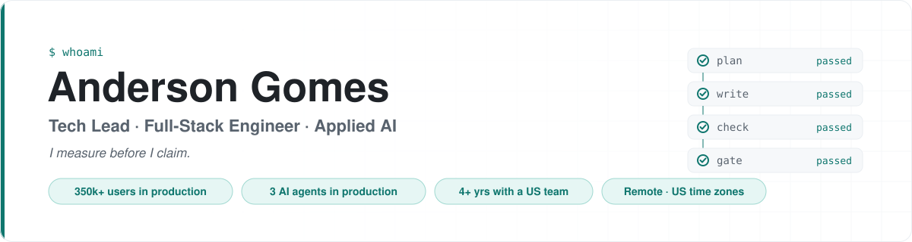

<picture>
  <source media="(prefers-color-scheme: dark)" srcset="assets/banner-dark.svg">
  
</picture>

  
  
  

Tech lead and software engineer. I build AI platforms end to end — architecture,
payments, infrastructure, and the operational work that keeps them running.

## What I'm building

<table>
<tr>
<td width="33%" valign="top">

### [as-advertised](https://github.com/Andgomes11/as-advertised)

A rules engine that checks whether a digital offer delivers what its ad promised —
and whether the domain selling it belongs to the brand it invokes.

</td>
<td width="33%" valign="top">

### [nabuco](https://github.com/Andgomes11/nabuco)

A team of AI agent employees for Claude Code and Codex that learns from the
mistakes it fixes: approved plans, one writer at a time, an evidence gate.

</td>
<td width="33%" valign="top">

### [conferente](https://github.com/Andgomes11/conferente)

An agent harness that never presents unchecked model output as checked.
Verification is code, never a model call.

</td>
</tr>
</table>

<b>The ad that started as-advertised</b>

 

A real ad showed *“50 items”* next to *“R$ 17.90”*, when fifty items cost R$ 315.
No claim in it was false — the deception lived in the composition and in one
omitted phrase. Two sweeps over 50 Brazilian consumer brands, precision measured
round to round, every positive finding opened by hand before it counted.

## What I do at work

I lead **career.guide** technically: an AI career-guidance
platform that has reached **350k+ users**, peaking at ~2,000 a day, B2C and B2B,
in three languages.

- **Platform architecture** — the stack of our new mobile product: a TypeScript
  monorepo with NestJS, PostgreSQL, React Native (Expo) and Next.js on Cloudflare
  Workers, contract-first APIs, and a CI pipeline with one required gate
- **AI-agent development harness** — enforced agent rules, specialised review
  subagents, and hooks that protect tests and migrations
- **Applied AI** — multi-agent architecture with specialised agents, persistent
  memory and RAG over vector stores
- **Payments** — Stripe, dLocal, PayPal and Pix, routed per country
- **Serverless** — AWS Lambda, API Gateway, SQS and S3, with standardised CI/CD

I came into this from QA automation, which is where the habit of not trusting a
green result started.

## How I work

I measure before I claim. On as-advertised that meant opening every positive
finding by hand before reporting it — six of eight died there, and the rule is
written into the repository rather than into a slide. When a number moves between
runs I look for a misbehaving source before I credit my own fix, because a source
that degrades quietly degrades toward *fewer* findings, and that reads as “nothing
here”.

## Stack

  

TypeScript · Node · NestJS · PostgreSQL · Prisma · React Native · Next.js · Python ·
AWS Lambda · API Gateway · SQS · Cloudflare · Docker · MongoDB · Cypress · GitHub Actions

## Reach me

**andersongds37@gmail.com** · [linkedin.com/in/andgomes](https://www.linkedin.com/in/andgomes)

Open to full-time remote roles with US teams (US time zones), and to consulting —
strongest in applied AI, platform architecture, payment integrations, and
serverless.
